  

# 🛡️ Awesome Security, Privacy & Trust Center Platforms ✨

  
  
  
  
  
  

> 🌟 A curated directory of top **Security, Privacy, and Customer Trust Center platforms** 🛡️, compliance posture portals 📑, AI-powered security questionnaire response engines 🤖, and Governance, Risk, and Compliance (GRC) solutions 📊. Explore both leading enterprise commercial SaaS solutions and self-hosted open-source alternatives.

---

## 📋 Table of Contents 📑

- [🌐 Sector Overview & Market Dynamics](#-sector-overview--market-dynamics-)
- [🟦 SaaS & Hosted Trust Platforms](#-saas--hosted-trust-platforms-)
- [🟩 Open-Source Trust & Compliance Software](#-open-source-trust--compliance-software-)
- [📊 Feature Comparison Matrix](#-feature-comparison-matrix-)
- [🤝 Contributing](#-contributing-)
- [💖 Support](#-support-)
- [📈 Star History](#-star-history)
- [📄 License](#-license-)

---

## 🌐 Sector Overview & Market Dynamics 📈

The Security, Privacy, and Trust Center market—operating within the continuous compliance automation and digital trust domain—is currently valued at approximately **$3 billion** and projected to exceed **$13.4 billion** by the 2030s, growing at a rapid CAGR of **16.4% to 31.2%** 🚀.

Market dynamics exhibit a **moderately fragmented yet rapidly consolidating landscape** 🧩: while enterprise GRC incumbents and major cloud security suites (e.g., OneTrust, ServiceNow, Microsoft) anchor legacy enterprise spending, fast-growing compliance leaders (such as Vanta and Drata) and focused trust center point solutions (SafeBase, Conveyor) compete intensely for high-velocity mid-market sales acceleration ⚡. This dynamic has driven steady M&A consolidation—such as Drata's $250M acquisition of SafeBase—moving the ecosystem away from isolated point questionnaires toward unified continuous compliance postures and customer trust centers 🤝.

---

## 🟦 SaaS & Hosted Trust Platforms ☁️

Below is an overview of commercial SaaS Trust Center, compliance automation, and security questionnaire platforms, ranked in descending order by company scale (valuation / annual revenue) 🏢.

| Platform | 🏢 Company Valuation / Revenue Scale | 💵 Specific Starting Tier Pricing | 🎁 Free Tier / Trial Limits | 🎯 Key Strengths & Focus |
|:---|:---|:---|:---|:---|
| **[OneTrust](https://www.onetrust.com/)** | **$4.5B Valuation** (~$500M+ ARR) | Starting at **$10,000/year** (custom modular plans, min. annual floor) | **No free tier or trial**; standalone free web utility scans only | 🌐 Enterprise privacy lifecycle, consent management, data mapping, GRC, and privacy trust center. |
| **[Vanta](https://www.vanta.com/)** | **$4.2B Valuation** (~$300M ARR) | Starting at **$10,000/year** (Essentials tier for early startups) | **No free tier or trial**; demo and scheduled POC sandbox through sales | 🛡️ Automated SOC 2, ISO 27001 compliance, continuous monitoring, and integrated customer Trust Center. |
| **[Drata](https://drata.com/)** | **$2.0B Valuation** (~$100M ARR) | Starting at **$7,500/year** (Foundations tier for small startups) | **No free tier or trial**; private sandbox / guided partner POC only | 📑 Automated audit evidence collection, continuous compliance, vendor risk, and trust posture publishing. |
| **[TrustArc](https://trustarc.com/)** | **$60M–$85M ARR** (Main Capital Partners PE) | Starting at **$10,000/year** (entry-level module packaging) | **No free tier for core suite**; limited free trial only for standalone Nymity research database | 🔐 Enterprise privacy management framework, DPIA/PIA automation, consent, and regulatory trust certificates. |
| **[SafeBase](https://safebase.io/)** | **$250M Valuation** (Acquired by Drata; ~$10M+ ARR) | Starting at **$5,000/year** (paid tier with CRM integrations) | **Free Forever tier** (Foundation plan: 1 public trust portal, document hosting, clickwrap NDAs, access workflows) | 🚀 Interactive public security posture portal, automated clickwrap NDAs, and AI-assisted questionnaire filling. |
| **[Whistic](https://www.whistic.com/)** | **$11M–$17M ARR** ($51M total VC funding) | Starting at **$15,000/year** (AWS marketplace baseline vendor tier) | **Free Basic Profile** (Zero-cost vendor profile to publish standard security posture and self-assessments) | 🔍 Dual-sided vendor risk management (TPRM), security profile catalog, and automated questionnaire exchange. |
| **[Conveyor](https://www.conveyor.com/)** | **$40M Funding** (Series B, ~$5M+ ARR) | Starting at **$5,000/year** (Credit-based tier with AI questionnaire workflows) | **Free Trust Center** ($0 forever; NDA-protected document sharing for up to 120 customer accounts/year) | 🤖 AI-powered security questionnaire completion and self-serve customer trust center portal. |

---

## 🟩 Open-Source Trust & Compliance Software 💻

Self-hosted, transparent, and community-driven solutions for public trust centers, continuous compliance evidence gathering, and zero-egress questionnaire responding. Ranked in descending order by GitHub community stars ⭐.

| Repository | ⭐ GitHub Stars | 🛠️ Tech Stack | 🎯 Primary Focus & Capabilities |
|:---|:---:|:---|:---|
| **[intuitem/ciso-assistant-community](https://github.com/intuitem/ciso-assistant-community)** |  | Python / Django / React | 🏢 All-in-one GRC platform for Risk, Compliance, Audits, and TPRM with 200+ global framework mappings (ISO 27001, SOC 2, NIST, NIS2). |
| **[strongdm/comply](https://github.com/strongdm/comply)** |  | Go / Markdown | 📝 SOC 2-focused compliance automation CLI framework: manage policies as code, track employee onboarding, and produce audit-ready records. |
| **[getprobo/probo](https://github.com/getprobo/probo)** |  | Go / PostgreSQL / GraphQL | 🛡️ Developer-first GRC engine with built-in **Compliance Page** (public trust portal), NDA gating, 270+ MCP AI agent tools, and audit logs. |
| **[bmarsh9/gapps](https://github.com/bmarsh9/gapps)** |  | Go / Vue.js | 📊 Open-source security compliance tracker supporting SOC 2, CMMC, ASVS, ISO 27001, HIPAA, NIST CSF, and PCI DSS controls. |
| **[ethyca/fides](https://github.com/ethyca/fides)** |  | Python / FastAPI / React | 🔒 Privacy-as-code and data governance platform featuring a user-facing **Privacy Center** for handling DSAR, consent, and cookie tracking. |
| **[theopenlane/core](https://github.com/theopenlane/core)** |  | Go / GraphQL / Ent | ⚡ Modern open-source compliance engine and control framework automating evidence gathering across SOC 2, GDPR, and ISO 27001. |
| **[LeeMangold/OpenGRC](https://github.com/LeeMangold/OpenGRC)** |  | PHP / Laravel / Vue.js | 📑 Lightweight self-hosted GRC platform for managing organizational risks, vendor assessments, security policies, and internal audit workflows. |
| **[transilienceai/shasta](https://github.com/transilienceai/shasta)** |  | Python / Cloud Security | ☁️ Open-source cloud security and continuous compliance monitoring platform supporting multi-cloud environments across 14+ compliance standards. |
| **[Morningstar/GoASQ](https://github.com/Morningstar/GoASQ)** |  | Go | 📋 General Open Architecture Security Questionnaire: standardized, code-based security evaluation tooling for architectures and vendors. |
| **[kodustech/trust-center](https://github.com/kodustech/trust-center)** |  | Next.js / TypeScript / Supabase | 🌐 Free, self-hosted, YAML-driven public trust center builder. Define policies and certifications in YAML to generate a branded security portal. |
| **[Polycentric-Labs/evidentia](https://github.com/Polycentric-Labs/evidentia)** |  | Python / OSCAL | 🔬 Compliance-as-code automation library with NIST OSCAL catalog support, cryptographic evidence verification (Sigstore), and gap analysis. |
| **[scorpionus007/QResponder](https://github.com/scorpionus007/QResponder)** |  | Python / FastAPI / Local LLM | 🔏 Local-first, zero-egress security questionnaire responder that grounds and cites answers strictly from local security documentation. |
| **[Hanalyx/OpenWatch](https://github.com/Hanalyx/OpenWatch)** |  | Go / PostgreSQL / React | ⏱️ Continuous compliance platform and dashboard for Linux fleets, producing temporal audit evidence exports for CIS, STIG, and NIST 800-53. |
| **[PatricR73/Questionnaire-Responder](https://github.com/PatricR73/Questionnaire-Responder)** |  | Python / SQLite / Streamlit | 🔍 Vendor questionnaire auto-drafting utility with verbatim policy citations, reviewer approvals, and automated security documentation gap analysis. |

---

## 📊 Feature Comparison Matrix ⚖️

| Platform / Tool | 🏷️ Type | 📜 License | 🌐 Public Trust Portal | 🤖 Questionnaire Automation | ⏱️ Continuous Monitoring | 🏠 Self-Hosted Deployment |
|:---|:---:|:---:|:---:|:---:|:---:|:---:|
| **OneTrust** | Commercial SaaS | Proprietary | ✅ | ✅ | ✅ | ❌ |
| **Vanta** | Commercial SaaS | Proprietary | ✅ | ✅ | ✅ | ❌ |
| **Drata** | Commercial SaaS | Proprietary | ✅ | ✅ | ✅ | ❌ |
| **TrustArc** | Commercial SaaS | Proprietary | ✅ | ❌ | ✅ | ❌ |
| **SafeBase** | Commercial SaaS | Proprietary | ✅ | ✅ | ✅ | ❌ |
| **Whistic** | Commercial SaaS | Proprietary | ✅ | ✅ | ❌ | ❌ |
| **Conveyor** | Commercial SaaS | Proprietary | ✅ | ✅ | ❌ | ❌ |
| **intuitem/ciso-assistant-community** | Open Source | AGPL-3.0 | ❌ (Internal GRC) | ✅ (TPRM/Audits) | ✅ | ✅ |
| **strongdm/comply** | Open Source | Apache-2.0 | ❌ (CLI/Docs) | ❌ | ✅ | ✅ |
| **getprobo/probo** | Open Source | ISC | ✅ (Compliance Page) | ❌ (Agentic MCP) | ✅ | ✅ |
| **bmarsh9/gapps** | Open Source | AGPL-3.0 | ❌ (Dashboard) | ❌ | ✅ | ✅ |
| **ethyca/fides** | Open Source | Apache-2.0 | ✅ (Privacy Center) | ❌ | ✅ | ✅ |
| **theopenlane/core** | Open Source | Apache-2.0 | ❌ (API/Engine) | ❌ | ✅ | ✅ |
| **LeeMangold/OpenGRC** | Open Source | GPL-3.0 | ❌ (Portal) | ✅ | ✅ | ✅ |
| **kodustech/trust-center** | Open Source | MIT | ✅ (YAML Portal) | ❌ | ❌ | ✅ |
| **scorpionus007/QResponder** | Open Source | MIT | ❌ | ✅ (Zero-Egress) | ❌ | ✅ |
| **Hanalyx/OpenWatch** | Open Source | AGPL-3.0 | ❌ (Audit Trail) | ❌ | ✅ | ✅ |
| **PatricR73/Questionnaire-Responder** | Open Source | MIT | ❌ | ✅ (Gap Report) | ❌ | ✅ |

---

## 🤝 Contributing 💡

Contributions are warmly welcomed! 🎉 If you know of an outstanding open-source security portal, privacy management toolkit, or questionnaire automation project that should be listed here:

1. 🔍 Review the repository criteria (must be open source and actively maintained).
2. 📋 Follow the table formatting guidelines with valid GitHub links and social star badges.
3. 🚀 Submit a pull request with a concise description of why the tool stands out.

---

## 💖 Support ☕

Thank you so much for using and exploring this curated directory! If you found this repository helpful for your security posture, privacy initiatives, or compliance workflows, please consider supporting the project:

- ⭐ **Star this repository** on GitHub to help others discover it!
- 🍴 **Fork the repo** and contribute new tools, updates, or feature additions.
- 📢 **Share the project** with fellow security engineers, compliance managers, and tech communities.
- ☕ **Buy a coffee / Sponsor**: If you'd like to support ongoing curation and open-source maintenance, please visit the [Sponsor Dashboard on GitHub Sponsors](https://github.com/sponsors/ishandutta2007). Your support is greatly appreciated! 🙌

---

## 📈 Star History

---

## 📄 License ⚖️

This repository and curated list are released under the [Creative Commons Zero v1.0 Universal](LICENSE) (Public Domain) 🌐. All third-party trademarks and project names belong to their respective holders.

---

  ⭐ <b>Star this repository if you found it helpful for your security, privacy, or trust architecture!</b> ⭐

